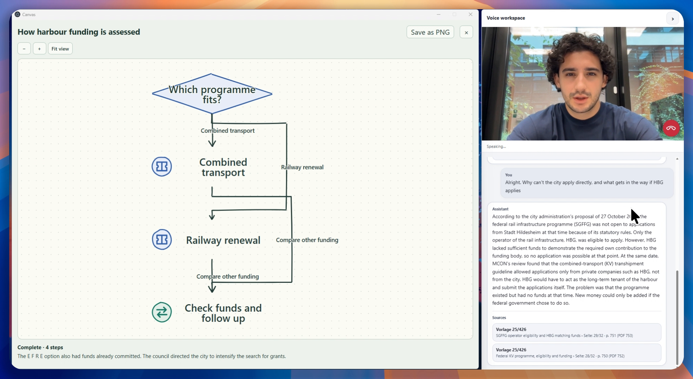
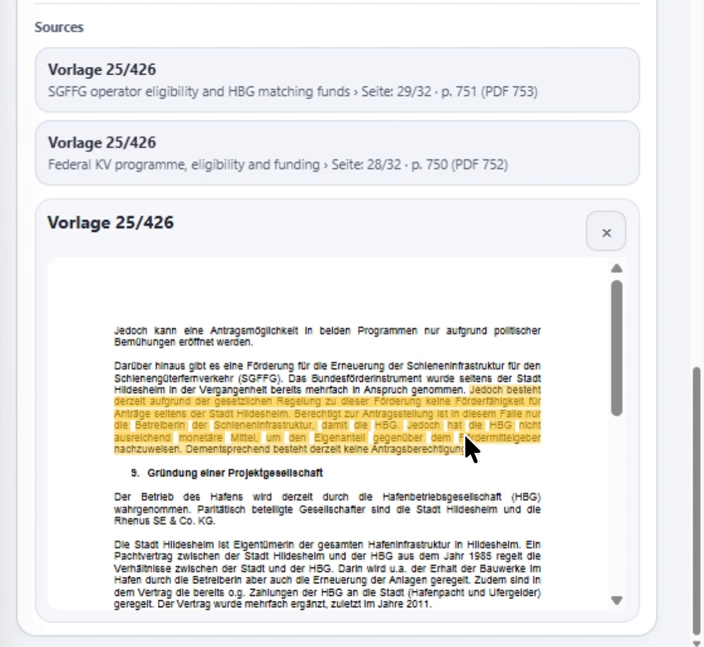

# Relay

**A voice workspace for municipal handovers.** Relay helps a new colleague understand an inherited project, verify the answer against the original documents, and turn that evidence into a next action.

[Watch the demo (2:28 · 60 fps)](https://github.com/DarshanScripts/scfh-2026/releases/download/harbour-demo/demo_60fps.mp4) · [Run on Windows](#run-on-windows) · [Harbour demo guide](docs/hildesheim-harbour-demo.md)

[](https://github.com/DarshanScripts/scfh-2026/releases/download/harbour-demo/demo_60fps.mp4)

## A handover in three steps

1. **Ask.** “Walk me through the funding stage of the Hildesheim Harbour project.” Relay reveals the funding routes as it explains them aloud.
2. **Verify.** “Why can’t the city apply directly?” Open a citation in the transcript to read the highlighted passage in the original budget.
3. **Act.** Ask Relay to open the handover register or save a brief on the desktop. The recording shows the desktop handoff stopping when the operator takes back control.



The Harbour demo uses published city documents and a clearly labelled simulated handover workspace. Relay says when the available sources do not support an answer.

## Run on Windows

Install Node.js 22.22+, Python 3.12+, and [uv](https://docs.astral.sh/uv/getting-started/installation/). From the repository root in PowerShell, run:

```powershell
npm.cmd ci
if (!(Test-Path .env)) { Copy-Item .env.example .env }
Push-Location packages/onboarding
uv sync --locked
npx.cmd --yes bun@1.4.5 install --frozen-lockfile
npx.cmd --yes bun@1.4.5 run build
Pop-Location
```

1. Add `LIVEKIT_URL`, `LIVEKIT_API_KEY`, `LIVEKIT_API_SECRET`, and `ANTHROPIC_API_KEY` to `.env`. The bundled Facilities sample is ready to try with these settings. For the Harbour sources and retrieval setup, follow the [Harbour demo guide](docs/hildesheim-harbour-demo.md#run-the-harbour-demo-on-windows).
2. On an unlocked desktop, run `./start.cmd` and select **Start call**. Wait for **Listening**. Try “What do I need before I open a maintenance ticket?” in Facilities mode.
3. Use `./restart.cmd` after changing settings and `./stop.cmd` to stop the app. Startup logs are in `.hcu/`.

English and German transcription are enabled by default. Set `LIVEKIT_VOICE_ID=Enceladus` for Gemini speech through LiveKit. For video, set `ENABLE_AVATAR=1` and `BEYOND_PRESENCE_API_KEY` and optionally choose an avatar with `BEYOND_PRESENCE_AVATAR_ID`. The call continues with voice if video is unavailable.

During desktop control, the border shows that Relay is active. Press **Ctrl+Alt+Shift+Backspace** to take over. During a walkthrough, speak or close Canvas to interrupt it.

## Project guides

- [Demo rehearsal](docs/demo-rehearsal.md) for the Facilities scenarios.
- [Windows acceptance checks](docs/windows-acceptance.md) for the voice, Canvas, and desktop tests.
- [Onboarding package](packages/onboarding/README.md) for the portable retrieval and browser harness.
- [Harbour corpus](packages/onboarding/harbour-corpus/README.md) for source provenance and indexing.
