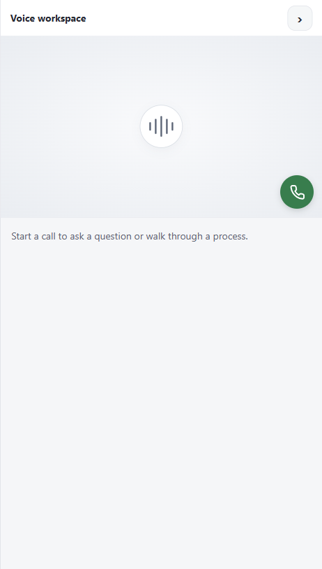
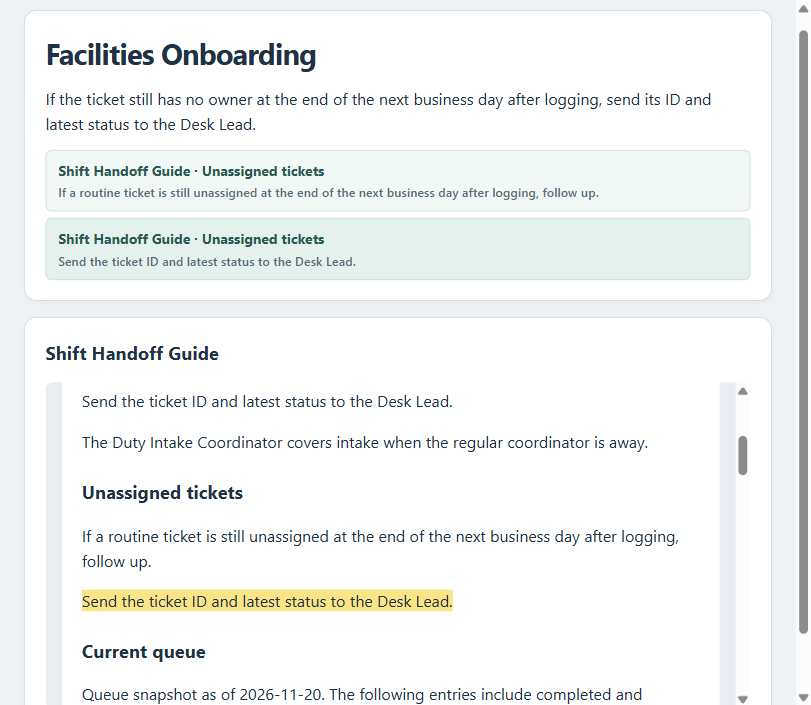

# Facilities Voice Agent

A Windows voice sidebar for a fictional municipal Facilities Service Desk. Ask an onboarding question, open its PDF or Word source inline, follow a narrated workflow, or ask the assistant to use the desktop.



## Run on Windows

Install Node.js 22.22+, Python 3.12+, and [uv](https://docs.astral.sh/uv/getting-started/installation/). Run these commands in PowerShell from the repository root.

```powershell
npm.cmd ci
if (!(Test-Path .env)) { Copy-Item .env.example .env }
Push-Location packages/onboarding
uv sync --locked
npx.cmd --yes bun@1.4.5 install --frozen-lockfile
npx.cmd --yes bun@1.4.5 run build
Pop-Location
```

Set `LIVEKIT_URL`, `LIVEKIT_API_KEY`, `LIVEKIT_API_SECRET`, and `ANTHROPIC_API_KEY` in `.env`. Use `LLM_MODEL` to select Claude and `REASONING_EFFORT=none` for the quickest replies. For video, set `ENABLE_AVATAR=1` and `BEYOND_PRESENCE_API_KEY`. The call switches to voice if the provider cannot start. Anam is reserved for a future video adapter.

Run `./start.cmd` on an unlocked desktop. The Electron sidebar opens on the right. Select **Start call** and wait for **Listening**, then **End call** to finish. Collapse the sidebar to keep the call running in a small edge tab. The canvas opens in the same window, and **Close canvas** restores the conversation and open citation. Use `./restart.cmd` to reload a running app after code or configuration changes. Use `./stop.cmd` to close it. Startup logs are in `.hcu/`.

## Try the demo

| Say | Check |
| --- | --- |
| “Open the Facilities onboarding folder.” | The assistant opens the sample guides in File Explorer. |
| “Open example.com in a new Chrome tab.” | The new tab opens and existing tabs stay available. |
| “What do I need before I open a maintenance ticket?” | The answer cites **Intake checklist**. Open the citation to highlight the PDF on page 2. |
| “A ticket has no owner. When do I follow up, and who do I tell?” | The Word citation highlights the reminder under **Unassigned tickets**. |
| “Which open ticket is due first, and who owns it?” | The answer cites **Current queue** for `FM-104` and the Desk Lead. |
| “Which ticket is due first, and what budget do we have for repairs?” | The answer cites the deadline and says the sources lack budget information. |
| “Walk me through a maintenance request from intake to handoff.” | The canvas reveals seven steps as they are spoken. Select **Save as PNG** to export the whole diagram. |
| “Draw a bar chart with 12 requests in January, 18 in February, and 15 in March.” | The canvas draws the chart from your values. |

The blue screen border marks active desktop control. Press **Ctrl+Alt+Shift+Backspace** to take over. To interrupt a walkthrough, speak or close its canvas.




## Verify

```powershell
node --test --test-timeout=60000 test/*.test.mjs
npm.cmd run test:desktop:windows -- --public
npm.cmd run test:voice
npm.cmd run test:voice -- --qa
npm.cmd run test:voice -- --walkthrough
```

Start the app before the voice tests. Add `--require-avatar` to require live video. See the [release checks](docs/windows-acceptance.md) and the [portable onboarding package](packages/onboarding/README.md) for its Linux harness and optional Qdrant mode.
