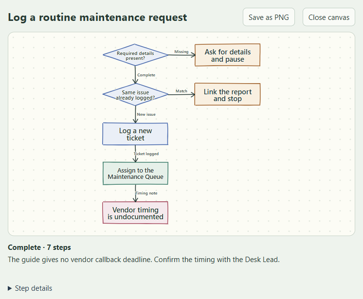

# SCFH 2026 · Facilities Voice Agent

A Windows desktop voice agent for the Smart City Future Hackathon. Use the floating orb to control local apps, get onboarding answers with highlighted PDF and Word citations, or follow a narrated workflow on the Rough.js canvas.



## Setup

Install Node.js 22.22 or newer, Python 3.12 or newer, and [uv](https://docs.astral.sh/uv/getting-started/installation/). From the repository root in PowerShell:

```powershell
npm.cmd ci
Copy-Item .env.example .env  # First run only
Push-Location packages/onboarding
uv sync --locked
npx.cmd --yes bun@1.4.5 install --frozen-lockfile
npx.cmd --yes bun@1.4.5 run build
Pop-Location
```

Fill in `LIVEKIT_URL`, `LIVEKIT_API_KEY`, `LIVEKIT_API_SECRET`, and `ANTHROPIC_API_KEY` in `.env`. Set `ENABLE_AVATAR=1` and `BEYOND_PRESENCE_API_KEY` for the optional avatar. `BEY_AVATAR_ID` selects a specific avatar. If Windows cannot find `uvx`, set `WINDOWS_MCP_UVX` to its full path.

## Try the app

Run `.\start.cmd` on an unlocked Windows desktop. Click the orb’s microphone and wait for the green rim.

| Say | Expect |
| --- | --- |
| “Open Calculator and click seven.” | Windows opens Calculator and clicks **7**. |
| “What do I need before I open a maintenance ticket?” | The spoken answer also appears in the companion panel. Click **Intake checklist** to highlight the source on PDF page 2. |
| “A maintenance ticket has no owner. Who do I tell?” | The companion panel cites the **Unassigned tickets** section in Word. |
| “Walk me through a maintenance request from intake to handoff.” | Seven documented steps draw as they’re narrated. At the end, open **Step details** or click **Save as PNG**. |
| “Draw a bar chart with 12 requests in January, 18 in February, and 15 in March.” | The canvas draws a chart using your values. |

Leave the mouse and keyboard idle for desktop actions. Speak during a walkthrough to interrupt it, or click **Close canvas**. Click the orb’s stop square to end the call. Use `.\restart.cmd` after changing settings and `.\stop.cmd` to close the app. If startup fails, check `.hcu/demo.error.log`.

## Checks

```powershell
npm.cmd run check:desktop
npm.cmd run test:desktop:windows
node --test --test-timeout=60000 test/rough-canvas.test.mjs test/onboarding-answer.test.mjs test/floating-window.test.mjs
npm.cmd run test:voice  # With the app running
npm.cmd run test:voice -- --qa
npm.cmd run test:voice -- --walkthrough
```

The Windows app uses the reviewed demo fixtures. For the standalone browser demo, Qdrant mode, and package tests, see [onboarding setup](packages/onboarding/README.md). See the [Rough.js handoff](docs/roughjs-windows-integration.md) for renderer details.
